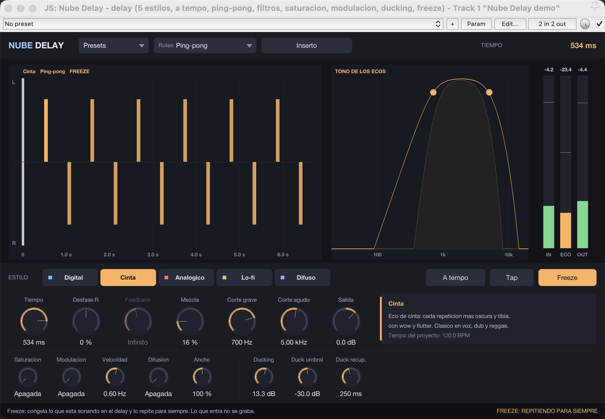

<!-- en -->
# Nube Delay

A free delay for [REAPER](https://www.reaper.fm), written as a JSFX (macOS / Windows / Linux), part of the
[Nube plugins](https://github.com/KevinMeneses/nube-plugins).



5 styles (Digital, Tape, Analog BBD, Lo-fi, Diffuse), ms or tempo-synced with tap, stereo / ping-pong / mono, right-channel offset, feedback with in-loop filters, saturation, modulation, diffusion, width, ducking, freeze, insert/send modes and 23 presets. Zero latency, ~1.6 % CPU.

**Install** — with [ReaPack](https://reapack.com): *Extensions → ReaPack → Import repositories*, paste
`https://github.com/KevinMeneses/nube-plugins/raw/main/index.xml`, then install **Nube Delay**. Or copy `nube_delay.jsfx`
into `REAPER/Effects/Nube Delay/` (on macOS `./install.sh` links it). It shows up as **JS: Nube Delay**. The interface is in Spanish.

**How it was made** — designed and built with [Claude Code](https://claude.com/claude-code). Since an AI can't
listen, every feature is verified by rendering test cases inside REAPER and comparing them with the theory
(`tests/run.sh`), plus mouse-driven UI tests (`tests/ui_test.py`).

**License** — GPL-3.0-or-later (see `LICENSE`).

---

## Español
Delay para REAPER (JSFX, macOS/Windows/Linux), hermano de [Nube Verb](https://github.com/KevinMeneses/nube-verb) y los demás Nube.


- **5 estilos**: **Digital** (limpio y exacto), **Cinta** (cada repetición más oscura y tibia, wow y flutter, el
  tiempo se desliza como cinta), **Analógico** (BBD: oscuro, suave, algo de chorus), **Lo-fi** (banda de teléfono,
  menos bits y muestreo) y **Difuso** (los ecos se desenfocan hacia reverb).
- **Tiempo** en ms (1 ms–2 s) o **a tempo** (1/32 a 1/1 con tresillos y puntillos, sigue el BPM) y **Tap**.
- **Ruteo**: estéreo, **ping-pong** (los ecos saltan L-R) o mono. **Desfase R** ±50 % (abre la imagen; +50 % = doble
  ancho tipo Haas).
- **Feedback** 0–100 %, **filtros en el lazo** (corte grave y agudo: cada repetición se filtra otra vez),
  **saturación**, **modulación** con velocidad, **difusión**, **ancho** 0–200 %.
- **Ducking**: el eco baja mientras cantas y vuelve en los silencios (umbral y recuperación).
- **Freeze**: repite para siempre lo que está sonando. **Uso**: inserto o envío (100 % eco).
- Gráficas: **patrón de ecos** (cada barra es una repetición, arriba L y abajo R; arrastra izquierda/derecha =
  tiempo, arriba/abajo = feedback) y **tono de los ecos** (primer y tercer eco; los puntos de corte se arrastran).
- Sin latencia. CPU: ~1.6 % de un núcleo por instancia con todo encendido.

## Instalar

```sh
./install.sh
```

Crea un enlace en `~/Library/Application Support/REAPER/Effects/Nube Delay/`. En REAPER aparece como **JS: Nube Delay**.

## Presets

| Preset | Qué hace |
|---|---|
| Voz - negra con ducking (cinta) | Cinta 1/4, 25 %, 18 %, 250 Hz–6 kHz, ducking 8 dB |
| Voz rap - 1/8 con puntillo ping-pong | Digital 1/8., ping-pong, 30 %, 16 %, 300 Hz–5 kHz, ducking 10 dB |
| Voz - retorno negra (envio) | Cinta 1/4, envío, 30 %, 300 Hz–5 kHz, ducking 6 dB |
| Slapback (rap 90s) | Cinta 110 ms, sin feedback, mono |
| Dub / dancehall (feedback alto) | Cinta 1/8., ping-pong, 70 %, 300 Hz–2.5 kHz, saturación 40 %, modulación 20 % |
| Cinta vieja | Cinta 1/8, 45 %, saturación 30 %, modulación 50 % |
| Analogico oscuro (BBD) | Analógico 1/4, 50 %, 3 kHz |
| Lo-fi / telefono | Lo-fi 1/8, 35 % |
| Ambient difuso (pads) | Difuso 1/4., 65 %, 35 %, ancho 150 % |
| Doble ancho (Haas) | 12 ms / R +50 %, sin feedback, ancho 200 % |
| Por defecto | Digital 1/4, 35 %, 25 % |

## Pruebas

- `tests/run.sh`: 38 renders (a 120 BPM), 55 chequeos: posición exacta de los ecos (a la muestra), feedback (±0.05 dB),
  a tempo (1/4 = 500 ms, 1/8. = 375 ms), ping-pong (cada eco solo en su lado), desfase R, mono, feedback 0 y 100 %,
  mezcla de potencia constante y sin latencia, cortes grave/agudo contra la fórmula, ducking (−12.0 dB con voz y
  vuelve en el silencio), ancho 0 %, saturación, modulación, difusión (pico −12 dB con la misma energía), freeze,
  los 5 estilos y los 23 presets con la voz.
- `tests/ui_test.py`: 17 pruebas de la interfaz con el mouse (incluye Tap y los menús). `tests/perf.lua`: CPU.

## Detalles técnicos

- Dos líneas de hasta 4 s con lectura Hermite de 4 puntos. El tiempo se desliza (tape) mientras suena y salta directo
  con el transporte detenido o al dar play.
- Lazo por canal: pasa-altos y pasa-bajos SVF de 2º orden → filtro del estilo → (Lo-fi: 8 bits y muestreo / 3) →
  saturación (aprox. de tanh) → bloqueo de DC → 4 pasa-todo de difusión → línea.
- Mezcla de potencia constante (seca × cos, eco × sin), como Nube Verb.

Nota sobre las pruebas: necesitan REAPER y Python con numpy, scipy y soundfile (`NUBE_PY=/ruta/a/python tests/run.sh`). Los casos con voz o música real usan grabaciones propias que no están en el repo (`tests/signals/`); sin ellas esos casos no se pueden correr.
